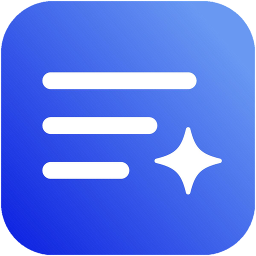

<p align="center">
  
</p>

<h1 align="center">Prompt Vault</h1>

<p align="center">
  Your personal prompt library. Every AI prompt you have ever written, saved in one calm place, searchable in seconds, and backed up to your own Google Drive.
</p>

<p align="center">
  <b>Version 0.1.0</b> · Windows · macOS · Linux
</p>

---

## ⬇️ Download

> ## Get Prompt Vault in under a minute
>
> **1.** Go to the [**latest release**](https://github.com/heyysam1/prompt-vault/releases/latest) page.
>
> **2.** Scroll to **Assets** at the bottom of that page.
>
> **3.** Download the **one file** that matches your computer from the table below.
>
> **4.** Open the downloaded file. That is all, no account needed to install.

| Your computer | ⬇️ Download this file | How to install |
| --- | --- | --- |
| **Windows 10 / 11** | `Prompt.Vault_0.1.0_x64-setup.exe` | Double-click it and follow the installer |
| **Windows (alternative)** | `Prompt.Vault_0.1.0_x64_en-US.msi` | Double-click it and follow the installer |
| **Mac with Apple Silicon** (M1, M2, M3, M4) | `Prompt.Vault_0.1.0_aarch64.dmg` | Open it, then drag **Prompt Vault** into **Applications** |
| **Mac with an Intel chip** | `Prompt.Vault_0.1.0_x64.dmg` | Open it, then drag **Prompt Vault** into **Applications** |
| **Linux, any distribution** | `Prompt.Vault_0.1.0_amd64.AppImage` | Right-click → Properties → allow executing as a program, then double-click |
| **Linux, Ubuntu / Debian / Mint** | `Prompt.Vault_0.1.0_amd64.deb` | Double-click to install with your software centre, or run `sudo dpkg -i <file>` |

**Not sure which Mac you have?** Click the Apple menu → *About This Mac*. If it says "Apple M1" (or M2, M3, M4), download the `aarch64` file. If it says "Intel", download the `x64` file.

**Not sure which Linux file?** Take the **AppImage**. It runs on almost every Linux system with no installation at all. Use the `.deb` only if your system is Ubuntu, Debian, Mint or similar.

### If your computer shows a security warning

Prompt Vault is a new, unsigned app, so your system may warn you the first time you open it. This is normal for independent apps. Here is what to do:

- **Windows (SmartScreen):** click **More info**, then **Run anyway**.
- **macOS ("unidentified developer"):** do not double-click the first time. Instead, **right-click (or Control-click) the app → Open → Open**. You only need to do this once. If macOS still blocks it, go to **System Settings → Privacy & Security** and click **Open Anyway**.
- **Linux:** for the AppImage, make sure "allow executing file as program" is switched on (see the table above).

<!-- The exact installer file names above are confirmed against the published v0.1.0 release assets before this README goes live. -->

---

## What is Prompt Vault?

If you work with AI every day, your best prompts end up scattered across chat windows, notes apps and screenshots, and the one you need is never the one you can find. Prompt Vault gives them one home: a lightweight desktop app with a clean, document-style editor, instant search, and optional AI features powered by **your own API key**.

Everything works fully offline. Your data lives on your computer, and it only goes anywhere when **you** sign in and back it up to **your own Google Drive**.

## ✨ Features

- **A calm prompt library** — Google Docs style cards with readable previews of the real content, pinning, a recent view, and a trash with restore
- **A full document editor** — rich formatting toolbar, many fonts (including the fonts installed on your PC), images you can resize and move, tables, checklists, links with hover previews, page colour and page setup saved per prompt, multiple document tabs inside one prompt, and a heading outline panel
- **Silent autosave** — no save button and no interruptions while you type; one quiet "Saved" note when you leave the editor
- **Search that understands** — fast keyword and fuzzy search built in; connect your own API key and you can also find prompts by *describing* them, even if you forgot the name
- **AI Chat and an in-editor AI assistant** — ask about your prompts, improve them, or find the right one by describing it, using your own key from Google Gemini, OpenAI, Anthropic, OpenRouter, or a local Ollama model
- **Rich templates** — a gallery of ready-made formats (headings, tables, checklists, image placeholders and more), each with a full preview, plus creating your own templates and "Save as Template" from any prompt
- **Share links** — send anyone a link and they see your prompt on a clean read-only web page, with a Copy button. No app install and no login needed on their side, just like a Google Docs "anyone with the link" share. Stop sharing any time and the link stops working
- **Notes** — a simple, spacious place for drafts and ideas that are not prompts yet
- **Insights** — total prompts, what you added and used this month, your daily streak, and a GitHub-style activity heatmap, all computed from your real usage
- **Google Drive backup and restore** — sign in with Google and keep a backup of your whole library in your own Drive's private app folder; restore it on any computer
- **Import / Export** — export everything as JSON or ZIP; import backups, TXT and Markdown files; download any single prompt as DOCX, TXT, Markdown, PDF or HTML
- **First-run guide** — a short introduction the first time you open the app, with Skip and Continue, replayable any time from Settings

## 📸 Screenshots

<!-- Screenshots to be added before the public launch: -->
<!--  -->
<!--  -->
<!--  -->

*Screenshots coming with the launch post. The app itself opens at a comfortable 1280 × 800 window, in a cream light theme or a neutral dark theme.*

## 🔒 Privacy

- **Local first.** Your prompts, notes and settings are stored on your own computer, in the app's data folder. The app works completely offline.
- **Your cloud, not ours.** Backup and sync go to **your own Google Drive**, in the app's private folder that other apps cannot see. There is no Prompt Vault server and no account with us.
- **Your API key stays yours.** AI features use the API key you provide. Keys are stored in a separate local file on your computer and are **never** included in backups, exports or shared links.
- **Sharing is explicit.** A prompt is only reachable through a share link if you choose to share that prompt, and you can stop sharing at any time.

## 🚀 Getting started

1. Install Prompt Vault from the [Download](#️-download) section above and open it.
2. A short 4-step guide appears the first time. Skip it or walk through it; you can replay it later from **Settings → View guide again**.
3. Add prompts with the **+** button, start from a template, or import your existing files.
4. Optional: open **Account & Sync** to sign in with Google for Drive backup, and add your AI provider's API key to switch on AI Chat, the editor assistant and meaning-based search.

### One-time Google sign-in setup (app owner)

Google requires every app to use its own free OAuth client before sign-in can run:

1. Open the [Google Cloud Console](https://console.cloud.google.com/) and create a project.
2. Enable the **Google Drive API**.
3. Create an **OAuth client ID** of type **Desktop app**.
4. In Prompt Vault, open **Account & Sync → Google sign-in setup** and paste the Client ID (and the secret, if one is issued).

No code changes are needed. Sign-in activates as soon as the Client ID is saved.

## 🛠️ Build from source

Requirements: [Node.js](https://nodejs.org/) 18 or newer, [Rust](https://rustup.rs/) (stable), and the [Tauri prerequisites](https://v2.tauri.app/start/prerequisites/) for your operating system.

```bash
npm install
npm run tauri dev      # run the app in development mode
npm run tauri build    # build installers for your own OS
```

Releases for Windows, macOS and Linux are built automatically by the GitHub Actions workflow in `.github/workflows/release.yml` whenever a version tag (for example `v0.1.0`) is pushed, or when the workflow is run manually.

**Tech:** Tauri v2 + Rust for a tiny, fast native app; a Vite + vanilla JavaScript frontend; local JSON storage with Google Drive `appDataFolder` backup.

## 📄 License

<!-- License to be chosen by the owner before the repository goes public. Placeholder: MIT. -->

*To be decided by the owner.*

---

<p align="center">
  Made by <a href="https://github.com/heyysam1">Mohammed Sami</a> · <a href="https://heyysami.bond">Personal Website</a>
</p>
